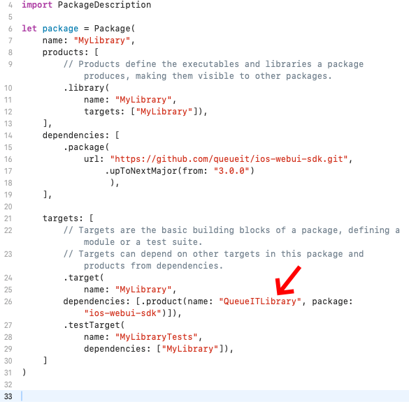
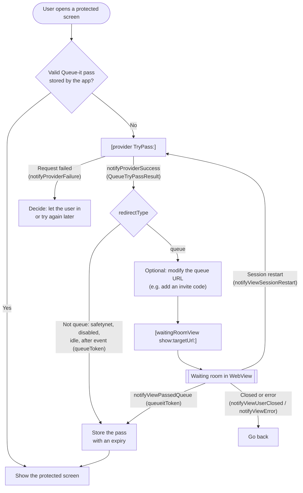
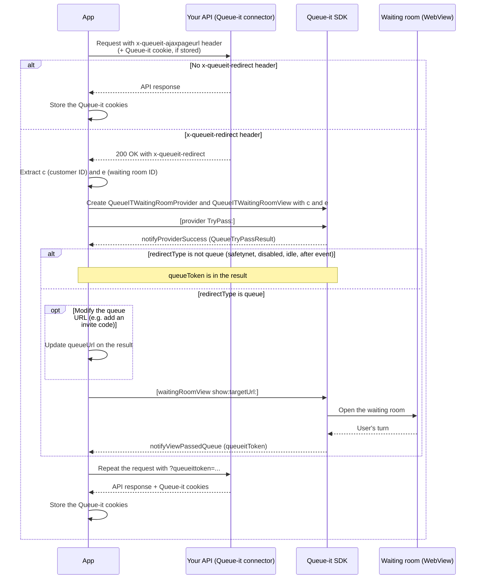

[](https://cocoapods.org/pods/QueueITLibrary)

# Queue-It iOS WebUI SDK

Library for integrating Queue-It's virtual waiting room into an iOS app that is written in either objective-c or swift.

## Installation

Before starting please download the whitepaper **Mobile App Integration** from GO Queue-it Platform.
This whitepaper contains the needed information to perform a successful integration.

### Requirements

In version 2.12.X the QueueITEngine will switch on the installed version of iOS as the old UIWebView has been marked deprecated from iOS 12. If the iOS version is above version 10.0.0 the newer WKWebView will be used instead of UIWebView.

Therefore the minimum iOS version for 2.12.X is 8.3, where WKWebViews were introduced. In the same round we have removed the target limit for iPhone only, so the library can be used with iPads as well.

From version 2.13.0 the QueueITEngine no longer supports the UIWebView and will only use WKWebView. Furthermore, the lowest supported version of iOS has been updated to version 9.3.

Version 3.0.0 introduces breaking changes as the interface to the legacy `QueueITEngine` has been modified so the `run` function is using the NSError pattern to return errors instead of throwing a NSException.

From version 3.5.2 the lowest supported version of iOS has been updated to version 12.0.

## Swift Package Manager

1. In Xcode, select File > Add Packages
2. For the URL, paste in `https://github.com/queueit/ios-webui-sdk.git`
3. Configure how you'd like to track changes, and add to your project
4. Finally, click Add Package

### Possible error generated when adding Package Dependency
* Error generated during build "product 'QueueIt' required by package 'mylibrary' target 'MyLibrary' not found"
* resolved by updating the dependency product name to "QueueItLibrary" for package "ios-web-sdk" 

#### Example: 


### XCFramework

You can manually add the XCFramework that's published in [releases](https://github.com/queueit/ios-webui-sdk/releases).

### CocoaPods [Deprecated]

> **Note**: CocoaPods distribution is deprecated and readonly. Last released SDK version to CocoaPods is `3.4.4` and no new updates will be published in the future. We recommend using [Swift Package Manager](#swift-package-manager) or [XCFramework](#xcframework) instead.

[CocoaPods](http://cocoapods.org) is a dependency manager for Cocoa projects. You can install it with the following command:

```bash
gem install cocoapods
```

To integrate the SDK into your Xcode project using CocoaPods, specify it in your `Podfile`:

```ruby
source 'https://github.com/CocoaPods/Specs.git'
platform :ios, '12.0'
use_frameworks!

target '<Your Target Name>' do
    pod 'QueueITLibrary', '~> 3.4.4'
end
```

Then, run the following command:

```bash
pod install
```


## Usage

The integration has two steps:

1. **Get the status of the waiting room** with `QueueITWaitingRoomProvider`, using one of these methods:
    * ```TryPass```
    * ```TryPassWithEnqueueToken```
    * ```TryPassWithEnqueueKey```

   The result is delivered to the ```notifyProviderSuccess``` callback as a ```QueueTryPassResult```, or to ```notifyProviderFailure``` if the status could not be retrieved.
2. **Show the waiting room**, if the visitor has to queue, by calling ```show:targetUrl:``` on `QueueITWaitingRoomView` with the ```queueUrl``` and ```targetUrl``` from the ```QueueTryPassResult```. The waiting room is shown in a web view, and ```notifyViewPassedQueue``` is called when it is the visitor's turn.

Because the two steps are separate, you decide in which layer of your app each one happens, and you can change the queue URL before the waiting room is shown ([read more about it here](#modifying-the-queue-url-before-showing-the-waiting-room)).

`QueueITWaitingRoomProvider` and `QueueITWaitingRoomView` are available from version ```3.1.14```.

### Lifecycle diagram



### Managing the queue state

As the App developer you must manage the state (whether user was previously queued up or not) inside the apps storage.
After you have received the ```notifyViewPassedQueue``` callback (or a ```QueueTryPassResult``` whose redirect type is not ```queue```), the app must remember this, possibly with a date / time expiration.
When the user goes to the next page - you check this state, and only call ```TryPass``` in the case where the user did not previously queue up.
When the user clicks back, the same check needs to be done.

### Example

The following example shows the basic idea of how to use the library.

In this example we have a `UITableViewController` that we want to protect using Queue-it. The header file of `TopsTableViewController` has the following signature:

```objc
#import <UIKit/UIKit.h>
#import "QueueITWaitingRoomProvider.h"
#import "QueueITWaitingRoomView.h"

@interface TopsTableViewController : UITableViewController<QueueITWaitingRoomProviderDelegate, QueueITWaitingRoomViewDelegate>
@property (nonatomic, strong) QueueITWaitingRoomProvider* waitingRoomProvider;
@property (nonatomic, strong) QueueITWaitingRoomView* waitingRoomView;
-(void)initAndTryPassQueueIt;
@end
```

The implementation of the example controller looks like follows:

```objc
-(void)initAndTryPassQueueIt
{
    NSString* customerId = @"yourCustomerId"; // Required
    NSString* waitingRoomIdOrAlias = @"yourWaitingRoomIdOrAlias"; // Required
    NSString* layoutName = @"yourLayoutName"; // Optional (pass nil if no layout specified)
    NSString* language = @"en-US"; // Optional (pass nil if no language specified)
    NSString* waitingRoomDomain = nil; // Optional (pass nil if no waitingRoomDomain specified, required for Bring Your Own CDN)
    NSString* queuePathPrefix = nil; // Optional (pass nil if no queuePathPrefix specified, required for Bring Your Own CDN)

    // Gets the status of the waiting room
    self.waitingRoomProvider = [[QueueITWaitingRoomProvider alloc] initWithCustomerId:customerId eventOrAliasId:waitingRoomIdOrAlias layoutName:layoutName language:language waitingRoomDomain:waitingRoomDomain queuePathPrefix:queuePathPrefix];
    self.waitingRoomProvider.delegate = self;

    // Shows the waiting room in a web view
    self.waitingRoomView = [[QueueITWaitingRoomView alloc] initWithHost:self customerId:customerId eventId:waitingRoomIdOrAlias];
    [self.waitingRoomView setViewDelay:5]; // Optional delay parameter you can specify (in case you want to inject some animation before Queue-It WKWebView will appear
    self.waitingRoomView.delegate = self;

    NSError* error = nil;
    BOOL success = [self.waitingRoomProvider TryPass:&error];
    /**
    To enqueue with an enqueue-token or key use one of the following:

    [self.waitingRoomProvider TryPassWithEnqueueKey:@"keyValue" error:&error];
    [self.waitingRoomProvider TryPassWithEnqueueToken:@"tokenValue" error:&error];
    **/
    if (!success) {
        if ([error code] == NetworkUnavailable) {
            // Thrown when Queue-It detects no internet connectivity
            NSLog(@"%ld", (long)[error code]);
            NSLog(@"Network unavailable was caught in TopsTableViewController");
            NSLog(@"IsRequestInProgress - %@", [self.waitingRoomProvider IsRequestInProgress] ? @"YES" : @"NO");
        }
        else if ([error code] == RequestAlreadyInProgress) {
            // Thrown when request to Queue-It has already been made and currently in progress. In general you can ignore this.
        }
        else {
             NSLog(@"Unknown error was returned by QueueITWaitingRoomProvider in TopsTableViewController");
        }
    }
}

#pragma mark - QueueITWaitingRoomProviderDelegate

// This callback will be called with the status of the waiting room.
-(void)waitingRoomProvider:(QueueITWaitingRoomProvider*)provider notifyProviderSuccess:(QueueTryPassResult*)queuePassResult {
    NSString* redirectType = queuePassResult.redirectType;
    if ([redirectType isEqualToString:@"safetynet"]) {
        // The user can pass without visiting the waiting room.
        // Store the session information, the same way as in notifyViewPassedQueue.
        NSLog(@"QUEUE TOKEN: %@", queuePassResult.queueToken);
        return;
    }
    if ([redirectType isEqualToString:@"disabled"] || [redirectType isEqualToString:@"idle"] || [redirectType isEqualToString:@"afterevent"]) {
        // The waiting room is disabled, idle or after the event (the result also carries a queueToken).
        // Most likely the application should still function, but the waiting room's state can be changed at any time,
        // so session handling is important.
        NSLog(@"Queue is disabled");
        return;
    }

    // Any other redirect type (normally "queue"): the user has to visit the waiting room.
    // This is where you can modify the queue URL, see "Modifying the queue URL before showing the waiting room".
    [self.waitingRoomView show:queuePassResult.queueUrl targetUrl:queuePassResult.targetUrl];
}

// This callback will be called when the status of the waiting room could not be retrieved.
// Error code 3 means that the mobile application can't reach Queue-it's servers, most likely because the mobile device has no internet connection.
// Here you decide if the application should function or not now that is has no queue-it protection.
-(void)waitingRoomProvider:(QueueITWaitingRoomProvider*)provider notifyProviderFailure:(NSString*)errorMessage errorCode:(long)errorCode {
    NSLog(@"Queue-it error: %@ (%ld)", errorMessage, errorCode);
}

#pragma mark - QueueITWaitingRoomViewDelegate

// This callback will be called when the user has been through the queue.
// Here you should store session information, so user will only be sent to queue again if the session has timed out.
-(void)waitingRoomView:(QueueITWaitingRoomView*)view notifyViewPassedQueue:(QueuePassedInfo*)queuePassedInfo {
    NSLog(@"You have been through the queue");
    NSLog(@"QUEUE TOKEN: %@", queuePassedInfo.queueitToken);
}

// This callback will be called just before the webview (hosting the queue page) will be shown.
// Here you can change some relevant UI elements.
-(void)notifyViewQueueWillOpen:(QueueITWaitingRoomView*)view {
    NSLog(@"Queue will open");
}

// This callback will be called after the webview (hosting the queue page) has been shown.
-(void)notifyViewQueueDidAppear:(QueueITWaitingRoomView*)view {
    NSLog(@"Queue did appear");
}

// This callback will be called after a user clicks a close link in the layout and the WebView closes.
// The close link is "queueit://close". Whenever the user navigates to this link, the SDK intercepts the navigation
// and closes the webview.
-(void)notifyViewUserClosed:(QueueITWaitingRoomView*)view {
    NSLog(@"The queue view was closed.");
}

// This callback will be called when the user chooses to leave the queue (the default exit link in the layout).
// The SDK does not close the WebView in this case: close it yourself if the user should go back.
-(void)notifyViewUserExited:(QueueITWaitingRoomView*)view {
    NSLog(@"The user left the queue.");
    [view close:nil];
}

// This callback will be called when the user clicks on a link to restart the session.
// The link is 'queueit://restartSession'. Whenever the user navigates to this link, the SDK intercepts the navigation,
// closes the WebView and calls this callback.
// In this callback you would normally call TryPass/TryPassWithEnqueueToken/TryPassWithEnqueueKey in order to restart the queueing.
-(void)notifyViewSessionRestart:(QueueITWaitingRoomView*)view {
    NSLog(@"Session was restarted");
    [self initAndTryPassQueueIt];
}

// This callback will be called when the URL of the queue page changes.
-(void)waitingRoomView:(QueueITWaitingRoomView*)view notifyViewUpdatePageUrl:(NSString*)urlString {
    NSLog(@"Queue page URL changed: %@", urlString);
}

// This callback will be called when the SDK can't read the queue page after it has loaded.
// The WebView is closed before this callback is called.
-(void)waitingRoomView:(QueueITWaitingRoomView*)view notifyViewError:(NSError*)error {
    NSLog(@"WebView error: %@", error.localizedDescription);
}
```

### Modifying the queue URL before showing the waiting room

In ```notifyProviderSuccess```, after ```TryPass``` has delivered a ```QueueTryPassResult``` with the redirect type ```queue```, and before you call ```show:targetUrl:```, you can change the queue URL on the ```QueueTryPassResult```. For example, to send a visitor to an invite-only waiting room, add the invite code as the ```code``` query parameter. This SDK has no separate invite code setting, so this is how you pass it.

The ```queueUrl``` property of ```QueueTryPassResult``` can be changed, and ```show:targetUrl:``` loads the URL exactly as you pass it:

```objc
-(void)waitingRoomProvider:(QueueITWaitingRoomProvider*)provider notifyProviderSuccess:(QueueTryPassResult*)queuePassResult {
    NSString* redirectType = queuePassResult.redirectType;
    if ([redirectType isEqualToString:@"safetynet"] || [redirectType isEqualToString:@"disabled"] ||
        [redirectType isEqualToString:@"idle"] || [redirectType isEqualToString:@"afterevent"]) {
        // Handle as in the example above
        return;
    }

    NSURLComponents* components = [NSURLComponents componentsWithString:queuePassResult.queueUrl];
    NSMutableArray<NSURLQueryItem*>* queryItems = [components.queryItems mutableCopy] ?: [NSMutableArray array];
    // Replace an existing code parameter instead of adding a second one
    [queryItems filterUsingPredicate:[NSPredicate predicateWithFormat:@"name !=[c] 'code'"]];
    [queryItems addObject:[NSURLQueryItem queryItemWithName:@"code" value:@"yourInviteCode"]];
    components.queryItems = queryItems;
    queuePassResult.queueUrl = components.URL.absoluteString;

    [self.waitingRoomView show:queuePassResult.queueUrl targetUrl:queuePassResult.targetUrl];
}
```

> **Note**: Only add or change query parameters. Keep the scheme, host and path of the queue URL: the web view uses the host of the queue URL to decide which navigations belong to the waiting room.

## Bring Your Own CDN Implementation

Since version **3.5.0**, this library includes support for Bring Your Own CDN integrations through two new optional parameters.

When initializing `QueueITWaitingRoomProvider`, you can now specify:

| Parameter | Type | Required | Description |
|-----------|------|----------|-------------|
| `waitingRoomDomain` | `NSString*` | Optional | Custom Waiting Room domain to use for the requests from Mobile to Queue-it. Can be a Proxy Domain, if you are running Queue-it Bring Your Own CDN |
| `queuePathPrefix` | `NSString*` | Optional | Queue path prefix when using Bring Your Own CDN integrations |

> **Note**: These parameters are optional but **required** for Bring Your Own CDN integrations.

### Usage Example

```objc
self.waitingRoomProvider = [[QueueITWaitingRoomProvider alloc]
    initWithCustomerId:@"yourCustomerId" // Required
    eventOrAliasId:@"yourWaitingRoomIdOrAlias" // Required
    layoutName:@"yourLayoutName" // Optional (pass nil if no layout specified)
    language:@"en-US" // Optional (pass nil if no language specified)
    waitingRoomDomain:@"<custom waiting room domain>.com" // Optional (pass nil if no waitingRoomDomain specified)
    queuePathPrefix:@"queue"]; // Optional (pass nil if no queuePathPrefix specified)
```

> **Note**: `QueueITWaitingRoomView` takes no extra parameters: it loads the queue URL returned in the `QueueTryPassResult`. The rest of the delegates and calling methods stay the same.

# Using Queue-it server-side connector (KnownUser) to protect APIs, consumed by mobile app

If you are using Queue-it's server-side connector (KnownUser) to protect your API, you utilize this in your mobile app, to run a hybrid setup.

This greatly increases the protection and prevents visitors from bypassing the client-side Queue-it integration.

The flow in this setup is the following (simplified):
1. Mobile app calls API endpoints and includes the special Queue-it header
   Endpoint is protected by Queue-it connector
2. Queue-it connector has Trigger/Condition setup to match an Integration Action/Rule, with Queue action-type
3. Queue-it connector intercepts the requests to API and immediately responds with another special Queue-it header, containing information needed to show the Waiting Room
4. Mobile app shows the waiting room using the header from the Queue-it server-side connector

## Implementation

To integrate with a protected API we need to handle the validation responses that we may get in case the user should be queued.

All calls to protected APIs need to include the `x-queueit-ajaxpageurl` header with a non-empty value and a Queue-it accepted cookie (if present).
The integration can be described in the following steps:

1. API Request with `x-queueit-ajaxpageurl` *or* Queue-it accepted cookie is made
2. We get a response which may either be the API response or an intercepted response from the Queue-it connector
3. Scenario 1, user should not be queued (response does not have the `x-queueit-redirect` header)
    1. We store the Queue-it cookies from the response, to include in later API calls
4. Scenario 2, user should be queued
    1. If the user should be queued we'll get a `200 Ok` response with a `x-queueit-redirect` header. We need to extract the `c`(Customer ID) and `e` (Waiting Room ID) query string parameters from the `x-queueit-redirect` header, create a `QueueITWaitingRoomProvider` and a `QueueITWaitingRoomView` with them, call `TryPass` and show the waiting room with `show:targetUrl:`, just as you would normally do with the SDK ([read more about it here](#usage))
    2. We wait for the `notifyViewPassedQueue` callback and we store the QueueITToken passed to the callback (if the `QueueTryPassResult` is already passed through, the QueueITToken is its `queueToken`)
    3. We can repeat the API request, this time appending the `queueittoken={QueueITToken}` query string parameter, to prevent the server-side connector from intercepting the call again
    4. We store the Queue-it cookies from the final response, so they can be set in other API calls



## Client-side and server-side mobile integration (hybrid) with Queue-it Bring Your Own CDN

> Note: This only applies if you are using the Mobile SDK as a client-side protection *and* are using server-side protection using the Queue-it KnownUser Connector.

> If you are only using client-side protection, using the Mobile SDK, refer to the [Usage](#usage) section above.

If you are running Queue-it behind your own reverse proxy the Mobile Integration can also be setup to run behind your proxy. For the hybrid setup, your KnownUser connector will also need to run in "Bring Your Own CDN" mode. Please contact Queue-it Support, for any questions the KnownUser Connector Bring Your Own CDN Setup.

### Setup Mobile SDK with Bring Your Own CDN, with protected API

To do this simply use your Proxy Domain as the `waitingRoomDomain` parameter when initializing `QueueITWaitingRoomProvider`, after getting the Queue-it intercepted response back from your API.

If you are running Queue-it Waiting Room on the same domain as your normal website, you also need to provide the `queuePathPrefix` parameter, to ensure your proxy can route the request to Queue-it origin.

This means in above [Implementation](#implementation) section, point 4.1, you must also provide `waitingRoomDomain` and optionally `queuePathPrefix` to `QueueITWaitingRoomProvider`, to serve the Waiting Room through your reverse proxy.
